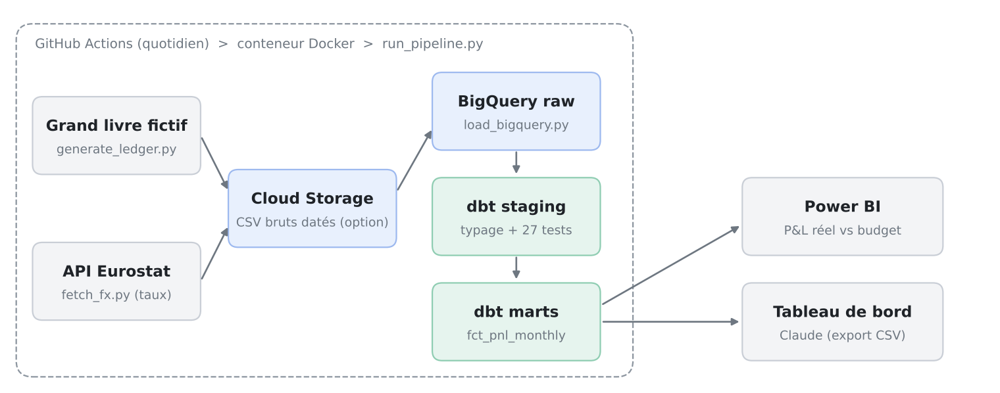
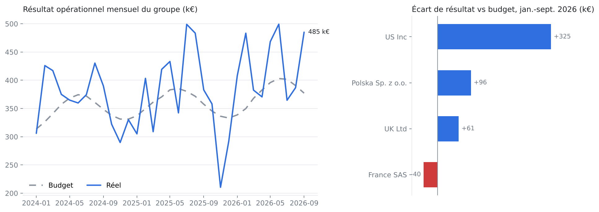

# FinGroup : pipeline de données financières dans le cloud

Pipeline automatisé qui consolide chaque jour le compte de résultat d'un groupe fictif de quatre filiales (France, Royaume-Uni, États-Unis, Pologne), le convertit en euros avec les taux de change officiels Eurostat, contrôle la qualité des données et alimente un rapport Power BI réel vs budget.

Projet personnel réalisé pour mettre en pratique une chaîne data complète sur un cas métier de contrôle de gestion : la consolidation multi-devises.

**Stack** : Python, Google BigQuery, dbt Core, Docker, GitHub Actions, Power BI.



## Ce que fait le pipeline

| Étape | Outil | Rôle |
|---|---|---|
| Ingestion | Python | Génère le grand livre et le budget (données fictives), récupère les taux de change mensuels via l'API Eurostat (`ert_bil_eur_m`) |
| Chargement | BigQuery | Charge les fichiers dans le dataset `raw` avec des schémas déclarés explicitement. Mode Cloud Storage disponible via la variable `GCS_BUCKET` |
| Transformation | dbt Core | Couche `staging` (typage, nettoyage) puis `marts` (P&L consolidé en EUR) |
| Qualité | Tests dbt | 27 tests bloquants : équilibre débit/crédit, couverture des taux, rapprochement grand livre vs table finale, clés, référentiels |
| Automatisation | Docker + GitHub Actions | Image unique lancée chaque jour à 4 h 30 UTC, ou à la demande |
| Restitution | Power BI | Rapport P&L réel vs budget connecté à la table finale |

## Données

- **Grand livre fictif** : environ 23 000 lignes d'écritures équilibrées, janvier 2024 au dernier mois clos, plan de comptes de type PCG (706, 601, 641, 645, 613, 625, 626, 681 et contreparties de bilan). Générateur déterministe (graine fixe), donc chaque exécution est reproductible.
- **Budget** mensuel par entité et par compte de résultat.
- **Taux de change réels** Eurostat : taux moyen du mois et taux de fin de mois, USD, GBP et PLN contre EUR.

## Règles de gestion

- Grain de la table finale `fct_pnl_monthly` : un mois x une entité x un compte de résultat.
- Convention de signe : produits positifs, charges négatives. Un écart positif est donc toujours favorable.
- Conversion au **taux moyen du mois**, pratique usuelle pour le compte de résultat.
- Le budget est converti **au même taux que le réel** : l'écart affiché est un écart de performance, sans effet change.

## Tests de qualité

En plus des tests génériques (unicité, non-nullité, valeurs autorisées, intégrité référentielle), quatre tests métier écrits en SQL :

| Test | Ce qu'il garantit |
|---|---|
| `assert_gl_entries_balanced` | Chaque écriture a un total débit égal au total crédit |
| `assert_fx_rate_available` | Chaque couple mois x devise du grand livre a un taux Eurostat |
| `assert_consolidated_matches_ledger` | Le résultat par entité de la table finale égale celui du grand livre (aucune ligne perdue dans les jointures) |
| `assert_pnl_monthly_unique_grain` | Aucun doublon dans la table finale |

Un test en échec arrête le pipeline : la table finale n'est pas mise à jour avec des données douteuses.

## Résultat



<!-- Ajouter ici la capture du rapport Power BI :  -->

## Structure du dépôt

```
ingestion/
  generate_ledger.py      grand livre et budget fictifs
  fetch_fx.py             taux Eurostat (JSON-stat)
  load_bigquery.py        chargement BigQuery, schémas explicites
dbt/
  models/staging/         5 vues de nettoyage
  models/marts/           fct_pnl_monthly
  tests/                  4 tests métier
run_pipeline.py           enchaîne les étapes, s'arrête à la première erreur
Dockerfile
.github/workflows/        exécution quotidienne
docs/                     schéma et visuels
```

## Lancer le projet

Prérequis : Python 3.10+, un projet Google Cloud avec BigQuery, le Google Cloud CLI.

```bash
gcloud auth application-default login
python -m venv .venv && source .venv/bin/activate   # Windows : .venv\Scripts\Activate.ps1
pip install -r requirements.txt
export GCP_PROJECT_ID=mon-projet                    # PowerShell : $env:GCP_PROJECT_ID="mon-projet"
python run_pipeline.py
```

Avec Docker :

```bash
docker build -t finpipe .
docker run --rm -e GCP_PROJECT_ID=mon-projet \
  -e GOOGLE_APPLICATION_CREDENTIALS=/creds/key.json \
  -v /chemin/vers/cle.json:/creds/key.json:ro finpipe
```

GitHub Actions : ajouter les secrets `GCP_SA_KEY` (clé JSON d'un compte de service avec les rôles BigQuery Data Editor et BigQuery Job User) et `GCP_PROJECT_ID`.

## Choix techniques et limites

- **BigQuery sandbox** (gratuit, sans carte) : pas d'instructions DML et expiration des tables à 60 jours. D'où des modèles dbt en `view` et `table` (pas d'`incremental`, qui génère un MERGE) et un rechargement complet quotidien.
- **Cloud Storage** est prévu dans le code mais nécessite un compte de facturation : en sandbox, les fichiers sont chargés directement dans BigQuery.
- **Données fictives** pour le grand livre et le budget ; seuls les taux de change sont réels.
- **Authentification** par clé de compte de service stockée en secret GitHub. Amélioration possible : Workload Identity Federation, sans clé.

## Pistes d'amélioration

- Corréler les coûts directs au chiffre d'affaires dans le générateur pour un résultat mensuel plus réaliste.
- Ajouter un effet change (réel au taux réel vs réel au taux budget).
- Modèles incrémentaux et partitionnement par mois une fois sorti du sandbox.
- Alerte par e-mail ou Slack en cas d'échec d'un test.
